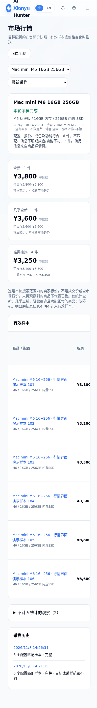

# 行情采样

项目现在默认监控行情，而非推荐购买。已有任务缺少 `monitor_mode` 时，SQLite 自动迁移为 `market`；原搜索范围、账号、调度、标题预筛和图片开关保留。历史购买推荐不转换为行情样本。兼容接口可显式设置 `monitor_mode: buying` 运行旧模式。

## Mac mini M6 16GB 256GB 示例

- 任务名称：`Mac mini M6 16GB 256GB`（明确出售品类和芯片，不只写内存硬盘）。
- 搜索词：`Mac mini M6`。
- 目标配置：`Mac mini，M6标准版，16GB统一内存，256GB内置SSD。仅功能正常；全新、几乎全新、轻微痕迹分别统计。`
- 使用 AI 配置核对。关键词模式仅缩小候选，命中后同样核对实际型号和报价，需要配置可用 AI。
- 若希望观察全部卖家，请关闭“仅个人卖家”；若不限制运费，请关闭“是否包邮”。已有任务的这些筛选不会被静默修改。
- 采样页数先用 1–3 页；保留人工验证暂停机制。降低额外页面访问不能保证不再触发平台验证。

行情使用 `prompts/market_prompt.txt`，在“系统设置 → Prompt管理”编辑。旧 `base_prompt` 和购买画像 criteria 文件不会用于行情分类。首次访问 Prompt 列表或首次运行时，从 `static/market_prompt.txt` 初始化，已有同名文件不覆盖。新建任务和编辑目标无需生成购买画像。

## 采集与核对

仅浏览搜索页和每个候选商品的详情页，不访问卖家主页、其他在售商品或评论。商品描述、图片、报价和卖家信用仅从商品详情获取，未提供的信息保留未知。

每轮重新观察历史商品以发现价格变化；同一轮商品 ID 去重。未绑定商品库的兼容任务中，任务名中的 Mac mini、芯片型号、内存和内置硬盘作为独立硬条件，描述补充缺失条件；绑定后以商品库选择为准。标题明确为其他代际时，直接跳过详情；比较、多配置、换机原因等歧义保留到详情核对。后台校验 AI 提取的实际品类和硬件字段，不能仅凭 AI 的 `match` 或目标词出现就通过。

例如 `MacBook Air M4 16+256，因换M6 Mac mini故出` 的出售品仍是 M4 笔记本，不能作为 M6 Mac mini 样本。M6 Pro、Max、Ultra 不等于 M6 标准版。配置证据不足、定金、配件、租赁、多配置起售价等不计入有效报价。

仅纳入功能正常的三个成色档：全新、几乎全新、轻微痕迹。故障机、明显磨损、成色或功能不明均排除，不作为有效样本或报价分布。成色档位来自页面证据的分类，不是对卖家描述真实性的担保。

## 统计和推送

“市场行情 / 行情记录”展示每轮有效样本、三档成色分布、中位数、最低/最高标价；同档至少 4 个样本才展示中间 50% 价格区间。结果为采样范围内卖家**在售标价**，不是成交价或全市场估值，不从少量样本推断涨跌趋势。示例截图为合成演示数据，不是真实行情。

仅在有效样本集合、价格或有效成色档发生变化时推送一条摘要，不再逐商品发送“新推荐”。故障机等排除项变化不会触发行情推送。比较基准是同一目标、Prompt和搜索范围下最近成功推送的快照；发送失败不推进基准，后续轮次可重试。多渠道任一失败时可能重复投递已成功的渠道。

验证、超时、分类失败、调试截断等标记为不完整采样，可查看已观察数据，但不发送行情变化或推进推送基准。“本轮未见”仅代表没有在本次搜索范围观察到，不代表已售。目标或范围改变后重新建立基准，不与旧范围混算。

历史逐商品数据保留在 `/results/legacy`。行情报告按轮保存到同一个应用 SQLite 数据库的 `market_reports`，通过只读 `/api/market/reports?task_key=0&limit=50` 查询。数据库和持久化目录需要正常备份；不会清除旧数据。

## NAS 更新

在能访问 NAS 的本地 Codex / 项目部署目录拉取最新 master 并更新 **app** 镜像即可：

```bash
docker compose pull app
docker compose up -d --no-deps app
```

自行构建部署使用 `docker compose build app`，然后执行上述 `up`。无需重建浏览器或删除浏览器 profile，保留网页登录状态。云端的实现和离线验证不代表 NAS 已更新；部署后运行一轮小范围任务，检查“市场行情”和企业微信摘要。




## 从商品库创建任务

新建 Mac mini 任务必须先“搜索商品库 → 选择具体芯片和核心版本 → 选择内存和内置 SSD → 确认配置 → 创建任务”。输入框可编辑显示名称和可选补充说明；闲鱼搜索词由所选型号自动生成，不再手填，后端也会统一生成，商品库选择是实际匹配的最高优先级，不会从说明里推断成其他型号。新建接口也校验型号 ID 和该机型支持的容量，拒绝不存在的型号和配置；不会在没找到型号时自动改选。

第一版为带官方来源的本地 Mac mini 元数据库，核对日期 2026-11-08；不是 TMDb，也不假称接入一个通用硬件 API。元数据随应用版本发布，创建任务和运行采样均不需要在线抓取规格。当前来源为苹果当前 Mac mini 技术规格页，以及官方 2024、2023、2020 技术规格归档，涵盖 M6、M5 Pro、M4/M4 Pro、M2/M2 Pro、M1。具有不同 CPU/GPU 核心组合的 Pro 机型单独列出，证据不足不能混为同一配置。

- 当前机型：<https://www.apple.com.cn/mac-mini/specs/>
- 2024：<https://support.apple.com/zh-cn/121555>
- 2023：<https://support.apple.com/zh-cn/111837>
- M1 2020：<https://support.apple.com/zh-cn/111894>

旧任务保留原记录，不自动猜测并绑定库内型号。请编辑一次任务，从商品库确认准确配置；绑定后该选择持久保存，不能用空值清除后退回猜测。纯文本旧任务仍按之前的逐项核对兼容运行。现有 Intel 或其他未收录的机型不会被伪造加入，后续可扩展商品库。

`GET /api/catalog/products?q=MacminiM6` 提供本地搜索；任务字段为：

```json
{"product_selection":{"catalog_id":"apple-mac-mini-m6","memory_gb":16,"storage_gb":256}}
```

参考项目 Mediary Scout 的“搜索元数据、人工选定、再提交任务”流程；没有引入它的运行时或媒体 API。商品库元数据定义位于 `src/domain/catalog/mac_mini.py`，每条带来源和核对日期；后续新增品类可复用相同的选择、持久化和核对流程。


