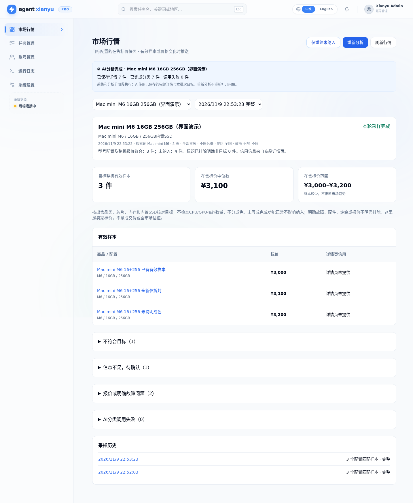
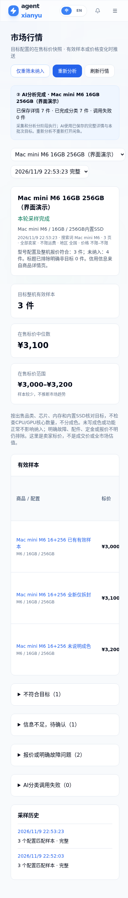
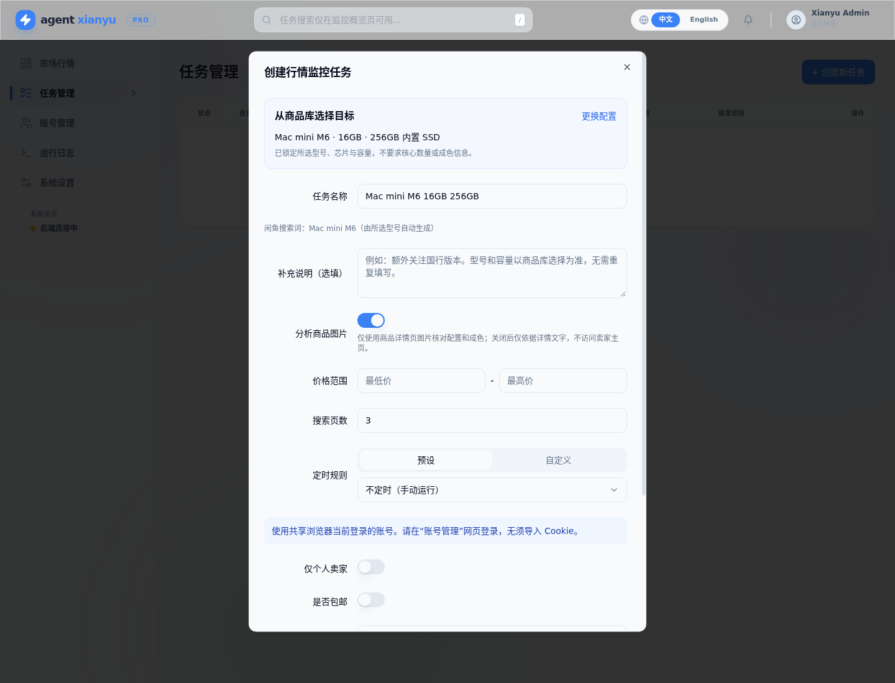
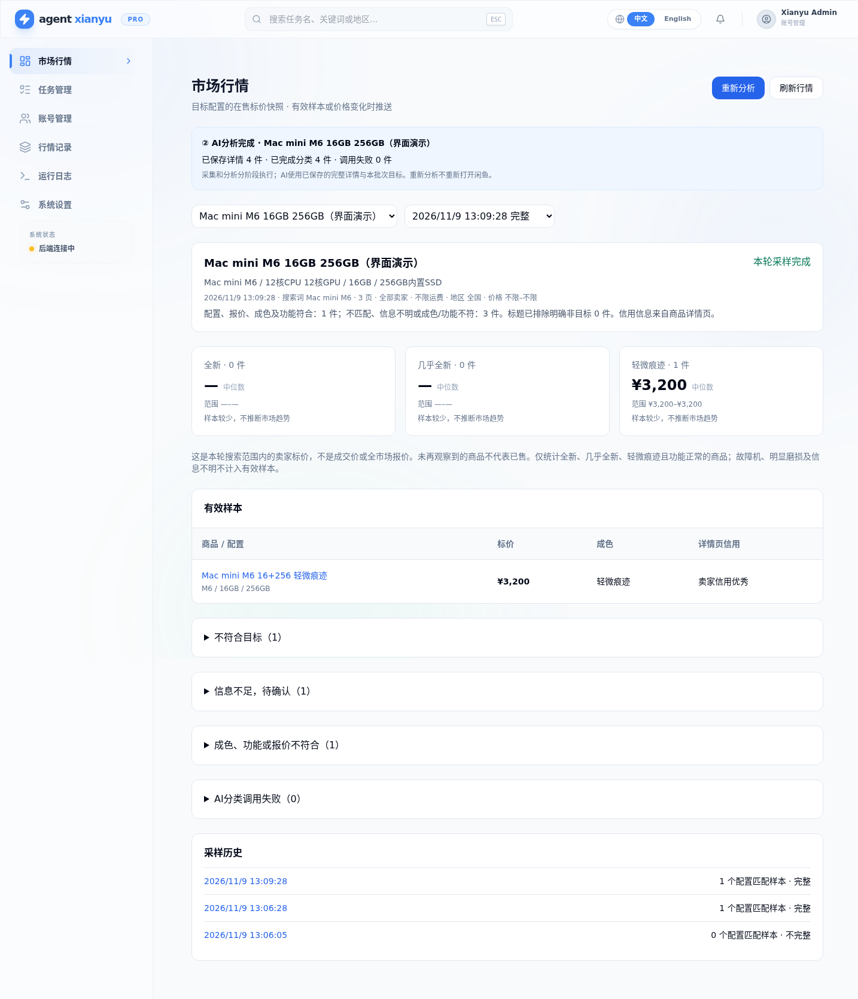

# 行情采样

项目现在默认监控行情，而非推荐购买。已有任务缺少 `monitor_mode` 时，SQLite 自动迁移为 `market`；原搜索范围、账号、调度、标题预筛和图片开关保留。历史购买推荐不转换为行情样本。购买推荐创建入口已退休；旧 `buying` 标记任务由CLI转入行情流程执行。

## Mac mini M6 16GB 256GB 示例

- 任务名称：`Mac mini M6 16GB 256GB`（明确出售品类和芯片，不只写内存硬盘）。
- 搜索词：`Mac mini M6`。
- 目标配置：`Mac mini，M6标准版，16GB统一内存，256GB内置SSD。只看符合该配置的在售整机。`
- 使用 AI 配置核对。关键词模式仅缩小候选，命中后同样核对实际型号和报价，需要配置可用 AI。
- 若希望观察全部卖家，请关闭“仅个人卖家”；若不限制运费，请关闭“是否包邮”。已有任务的这些筛选不会被静默修改。
- 采样页数先用 1–3 页；保留人工验证暂停机制。降低额外页面访问不能保证不再触发平台验证。

分类 Agent 使用随程序发布的内部规则 `static/market_prompt.txt` 和结构化任务目标。旧 Prompt 模板、购买标准生成器、生成进度界面及目录挂载已移除；运行时不读取或创建 `prompts` 目录。历史数据库中的文件路径列仅保留用于兼容旧数据，不再执行。

## 采集与核对

仅浏览搜索页和每个候选商品的详情页，不访问卖家主页、其他在售商品或评论。商品描述、图片、报价和卖家信用仅从商品详情获取，未提供的信息保留未知。

每轮重新观察历史商品以发现价格变化；同一轮商品 ID 去重。未绑定商品库的兼容任务中，任务名中的 Mac mini、芯片型号、内存和内置硬盘作为独立硬条件，描述补充缺失条件；绑定后以商品库选择为准。标题明确为其他代际时，直接跳过详情；比较、多配置、换机原因等歧义保留到详情核对。后台校验 AI 提取的实际品类和硬件字段，不能仅凭 AI 的 `match` 或目标词出现就通过。

例如 `MacBook Air M4 16+256，因换M6 Mac mini故出` 的出售品仍是 M4 笔记本，不能作为 M6 Mac mini 样本。M6 Pro、Max、Ultra 不等于 M6 标准版。配置证据不足、定金、配件、租赁、多配置起售价等不计入有效报价。

当前只做目标整机筛选，不做成色分档；未写成色、使用痕迹或功能正常不能作为排除理由。明确故障仍排除，未声明功能不等于故障。

## 统计和推送

“市场行情”展示目标整机的有效样本、中位数、最低/最高标价；至少 4 个样本才展示中间 50% 价格区间。结果为采样范围内卖家**在售标价**，不是成交价或全市场估值，不从少量样本推断涨跌趋势。示例截图为合成演示数据，不是真实行情。

仅在有效样本集合或价格发生变化时推送一条摘要，不再逐商品发送“新推荐”。故障机等排除项变化不会触发行情推送。比较基准是同一目标、Prompt和搜索范围下最近成功推送的快照；发送失败不推进基准，后续轮次可重试。多渠道任一失败时可能重复投递已成功的渠道。

验证、超时、分类失败、调试截断等标记为不完整采样，可查看已观察数据，但不发送行情变化或推进推送基准。“本轮未见”仅代表没有在本次搜索范围观察到，不代表已售。目标或范围改变后重新建立基准，不与旧范围混算。

历史逐商品数据保留在 `/results/legacy`。行情报告按轮保存到同一个应用 SQLite 数据库的 `market_reports`，通过只读 `/api/market/reports?task_key=0&limit=50` 查询。数据库和持久化目录需要正常备份；不会清除旧数据。

## NAS 更新

在能访问 NAS 的本地 Codex / 项目部署目录拉取最新 master 并更新 **app** 镜像即可：

```bash
docker compose pull app
docker compose up -d --no-deps app
```

自行构建部署使用 `docker compose build app`，然后执行上述 `up`。无需重建浏览器或删除浏览器 profile，保留网页登录状态。云端的实现和离线验证不代表 NAS 已更新；部署后运行一轮小范围任务，检查“市场行情”和企业微信摘要。




## 从商品库创建任务

新建 Mac mini 任务必须先“搜索商品库 → 选择具体芯片型号 → 选择内存和内置 SSD → 确认配置 → 创建任务”。输入框可编辑显示名称和可选补充说明；闲鱼搜索词由所选型号自动生成，不再手填，后端也会统一生成，商品库选择是实际匹配的最高优先级，不会从说明里推断成其他型号。新建接口也校验型号 ID 和该机型支持的容量，拒绝不存在的型号和配置；不会在没找到型号时自动改选。

第一版为带官方来源的本地 Mac mini 元数据库，核对日期 2026-11-08；不是 TMDb，也不假称接入一个通用硬件 API。元数据随应用版本发布，创建任务和运行采样均不需要在线抓取规格。当前来源为苹果当前 Mac mini 技术规格页，以及官方 2024、2023、2020 技术规格归档，涵盖 M6、M5 Pro、M4/M4 Pro、M2/M2 Pro、M1。商品库保留核心参数作为元数据，但当前选择按芯片聚合，不以核心数区分筛选目标。

- 当前机型：<https://www.apple.com.cn/mac-mini/specs/>
- 2024：<https://support.apple.com/zh-cn/121555>
- 2023：<https://support.apple.com/zh-cn/111837>
- M1 2020：<https://support.apple.com/zh-cn/111894>

旧任务保留原记录，不自动猜测并绑定库内型号。请编辑一次任务，从商品库确认准确配置；绑定后该选择持久保存，不能用空值清除后退回猜测。纯文本旧任务仍按之前的逐项核对兼容运行。现有 Intel 或其他未收录的机型不会被伪造加入，后续可扩展商品库。

`GET /api/catalog/products?q=MacminiM6` 提供本地搜索；任务字段为：

```json
{"product_selection":{"catalog_id":"apple-mac-mini-m6","memory_gb":16,"storage_gb":256}}
```

参考项目 Mediary Scout 的“搜索元数据、人工选定、再提交任务”流程；没有引入它的运行时或媒体 API。商品库元数据定义位于 `src/domain/catalog/mac_mini.py`，每条带来源和核对日期；后续新增品类可复用相同的选择、持久化和核对流程。



## 先采集，再分类与重新分析

每轮分为两个阶段：

1. **采集**只在标题层做保守预筛，并保存商品详情文字、图片地址、价格、详情页卖家信息。每个候选立即写入 SQLite 的 `market_candidates`，对应 `market_batches` 保存任务目标和采集状态。
2. **分类**在采集结束、浏览器页面与占用锁释放后执行。分类 Agent 按实际出售品理解完整详情和图片，并接收此批次的型号、芯片、内存、内置 SSD 和补充说明。不是用 M6 关键词出现就算匹配。“卖M4，因为换了M6”应输出实际出售品为M4，不计入M6行情。

分类默认逐条执行，避免并发请求触发服务限流；可恢复的失败最多自动重试一次，认证失败、模型未配置或服务拒绝参数时停止同批次重复请求。只保存脱敏错误类别，不保存 API Key 或提供商完整报错正文。旧版本用户模板不会覆盖当前分类契约。

行情页顶部“重新分析”对本批次已保存详情重新分类，不启动闲鱼采集，也不需要浏览器就绪。执行期间显示采集/分类进度并禁用重复点击。成功结果、错误和尝试次数按商品逐条保存，进程退出后可恢复；故障分类批次不会推进推送基准。较旧批次补分析不会向用户推送成当前新行情。

旧版报告没有独立采集包时，按钮尝试从本地 `result_items` 读取仍然存在的完整详情，使用**当前任务目标**建立复核批次。它可能是后续保存的本地详情，不能当作原报告时刻的完整快照，因此始终标为不完整历史复核，不发送新行情通知；缺失数据明确提示，不自动补抓。不符合目标、信息不足、明确故障/报价问题与模型调用失败分开展示，长列表按20条展开。

也可在 app 容器中独立运行：

```bash
python -m tools.classify_market_batch <批次ID>       # 仅继续失败/待分类项
python -m tools.classify_market_batch <批次ID> --all # 重新分析整个批次
```

目标按采集时快照保存；重新选择型号后，请创建新的采集轮次，避免把旧目标快照当作新目标的完整市场采样。采集被验证/超时打断的批次仍能复核已保存详情，但不推送市场变化。



## “信息不足，待确认”与证据核对

此分组包括实际缺少配置证据，以及 AI 尚未提供可核实出处的情况，不等于商品错误或卖家没写配置。分类说明与原文引文分开保存：`identity_evidence` 为解释，`evidence_quotes` 为标题、描述或图片的短片段，文本片段按各自来源核对。旧版 AI 将多段说明拼在一起时，只核实其中真实引号片段，不要求整段说明出现在详情中。缺少可核实引文时会补一次证据修正请求，仍无依据才保留待确认。

“准备换个内存”不会因为出现“换”字就被当成换机。只核对芯片提及处的上下文；“卖M4，因为换M6”仍不作为M6证据。商品品类、芯片、内存、内置硬盘有实际冲突时继续排除。

CPU/GPU核心数不参与筛选或补全，不发送到分类结构化目标中；旧批次即使保存了核心数也会忽略。只核对出售品类、芯片、内存和内置SSD。

导航仅保留“市场行情”，历史批次在同一页面查看；原 `/results` 地址跳转 `/dashboard`，历史原始记录的 `/results/legacy` 保留。


## 仅重筛未纳入

顶部“仅重筛未纳入”会保留当前报告的有效样本，模型只重新分析下方未纳入条目，包括不符目标、待确认、报价/明确故障以及调用失败；已有有效样本不会重复调用模型。全部结果仍按同一目标快照汇总。原“重新分析”保留整批重跑能力，两者都不访问闲鱼页面。

没有独立采集快照的旧版报告，需先完整重新分析一次再使用局部重筛；不会静默扩大为全量调用。CLI可使用 `python -m tools.classify_market_batch <批次ID> --excluded`。原始采集详情和历史数据保留。

当前分类不再把成色、必须声明功能正常、核心数或外壳接口布局作为门槛，补充说明中遗留的这些要求也忽略。明确故障、非整机报价、型号/容量不符与无法确认的真正配置仍单独标注。旧报告需点击局部重筛才能更新已保存的筛选结果。


